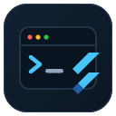

<div align="center">



# Flutter Terminal Helper

**Every Flutter and Dart CLI command you use, one click away in the VS Code sidebar.**

[](https://open-vsx.org/extension/Franklyn-R-Silva/flutter-terminal-helper)
[](https://open-vsx.org/extension/Franklyn-R-Silva/flutter-terminal-helper)
[](https://github.com/Franklyn-R-Silva/flutter-terminal-helper/actions/workflows/ci.yml)
[](https://www.bestpractices.dev/projects/17193)
[](LICENSE)

[Install](#installation) · [Usage](#usage) · [Commands](#command-catalog) · [Settings](#settings) · [Security](#security-and-quality) · [Contributing](CONTRIBUTING.md)

</div>

---

Flutter Terminal Helper adds a **Flutter Helper** view to the Activity Bar with 100+
commands for Flutter, Dart, FVM, Melos, Firebase, Supabase and GetX, grouped by task.
Click one and it is pasted into a dedicated terminal for you to review, or run
straight away if you prefer. No more digging through docs for the right flag.

The UI is available in **English** and **Portuguese (pt-BR)** and follows your
editor's display language.

## Features

| | |
| --- | --- |
| 🗂️ **Organized catalog** | Commands grouped into 15 categories, from `pub get` to `build web --wasm`. |
| 🔍 **Instant search** | <kbd>Ctrl</kbd>+<kbd>Alt</kbd>+<kbd>F</kbd> (<kbd>Cmd</kbd>+<kbd>Alt</kbd>+<kbd>F</kbd> on macOS) searches every command by name, flag or description. |
| ⭐ **Favorites & 🕘 Recent** | Pin the commands you use most; the last ones you ran are remembered across projects. |
| ✏️ **Argument prompts** | Commands that need a value (`pub add`, `run -d`, `fvm use`) ask for it before sending. |
| 🧭 **FVM aware** | Runs `flutter`/`dart` through `fvm` automatically when the project has an `.fvmrc`. |
| 🧩 **Your own commands** | Add team or project commands through a setting; they get their own category. |
| 🖥️ **One dedicated terminal** | Reuses a single named terminal instead of opening a new one per command. |
| 🪶 **Lightweight** | One ~20 KB file, no runtime dependencies, loads only when you open the view or search. |

## Installation

1. Open the Extensions view (<kbd>Ctrl</kbd>+<kbd>Shift</kbd>+<kbd>X</kbd>).
2. Search for **Flutter Terminal Helper** and click **Install**.

Each editor searches its own registry, and the extension is on both:

| Editor | Registry |
| --- | --- |
| VS Code | [Visual Studio Marketplace](https://marketplace.visualstudio.com/items?itemName=Franklyn-R-Silva.flutter-terminal-helper) |
| VSCodium, Cursor, Windsurf, Antigravity, Gitpod… | [Open VSX](https://open-vsx.org/extension/Franklyn-R-Silva/flutter-terminal-helper) |

From a terminal: `code --install-extension Franklyn-R-Silva.flutter-terminal-helper`
(use `codium`, `cursor`… for other editors). You can also download the `.vsix` of any version from
[GitHub Releases](https://github.com/Franklyn-R-Silva/flutter-terminal-helper/releases)
and use **Extensions: Install from VSIX…**.

**Requirements:** VS Code 1.80 or later (or a fork based on it). Flutter, Dart and the
other CLIs only need to be installed to actually run their commands.

## Usage

1. Click the **Flutter Helper** icon in the Activity Bar.
2. Expand a category and click a command: it is pasted into the **Flutter** terminal.
3. Press <kbd>Enter</kbd> to run it, or use the inline buttons:
   ▶ run now, ⭐ add to favorites, ⧉ copy to clipboard.

Prefer one-click execution? Set `flutterHelper.clickAction` to `run`.

## Command catalog

| Category | Examples |
| --- | --- |
| 🧹 Cleaning & Dependencies | `flutter clean`, `pub get`, `pub add`, `pub upgrade --major-versions`, `pod install` |
| 🏗️ Build | `build apk`, `apk --split-per-abi`, `appbundle`, `ipa`, `web --wasm`, desktop targets |
| ▶️ Run | `flutter run`, `run -d <device>`, `-d chrome`, `--profile`, `--release` |
| 📱 Devices | `devices`, `emulators --launch`, `attach`, `install`, `logs` |
| 🧪 Test & Analyze | `test --coverage`, `test --update-goldens`, `analyze`, `dart fix` |
| 🧰 Configuration | `doctor -v`, `upgrade`, `channel`, `precache` |
| 🎯 Dart | `dart run`, `analyze`, `compile exe`, `devtools` |
| 📦 Project | `flutter create`, `--platforms=…`, package and plugin templates |
| ⚙️ Code Generation | `build_runner build/watch`, `gen-l10n` |
| 🔥 Firebase | `flutterfire configure`, `firebase deploy` |
| 🧭 FVM | `fvm install`, `fvm use`, `fvm list`, `fvm doctor` |
| 🔍 Info | `flutter --version`, `dart --version` |
| 🟢 Supabase | `start`, `db push`, `migration new`, `functions deploy` |
| 📦 Melos | `bootstrap`, `run`, `exec`, `version`, `publish` |
| 🧩 GetX & Codegen | `get create page:`, `build_runner watch` |

Missing a command? [Suggest it](https://github.com/Franklyn-R-Silva/flutter-terminal-helper/issues/new/choose).
Adding one is a one-line change.

## Settings

| Setting | Default | Description |
| --- | --- | --- |
| `flutterHelper.clickAction` | `paste` | What a click does: `paste` (review first) or `run` (execute immediately). |
| `flutterHelper.terminalName` | `Flutter` | Name of the dedicated terminal. |
| `flutterHelper.reuseTerminal` | `true` | Reuse the dedicated terminal instead of creating a new one each time. |
| `flutterHelper.customCommands` | `[]` | Your own commands, shown in a **⭐ Custom Commands** category. |
| `flutterHelper.promptForArguments` | `true` | Ask for a value when a command expects an argument. |
| `flutterHelper.useFvm` | `auto` | Run `flutter`/`dart` through FVM: `auto` (detect `.fvmrc`), `on` or `off`. |
| `flutterHelper.recentLimit` | `8` | How many recent commands to keep (`0` disables the list). |

### Custom commands

```jsonc
// settings.json
"flutterHelper.customCommands": [
  { "label": "Build prod", "command": "flutter build apk --flavor prod -t lib/main_prod.dart" },
  { "label": "Gen + Run", "command": "dart run build_runner build -d && flutter run", "description": "Codegen then run" }
]
```

Each entry needs a `label` and a `command`; `description` is optional. End a command
with a space to be prompted for its last argument. The sidebar updates as soon as you
save.

## Security and quality

**Safe by default**

- **Workspace Trust:** in Restricted Mode, `customCommands` and `clickAction` from a
  folder's `.vscode/settings.json` are ignored, so an untrusted repository can't put
  its own commands in your sidebar or make a click run them.
- **Nothing runs on its own:** commands are only sent when you click them, and by
  default they are pasted for review, not executed.
- **No telemetry and no network access.** The extension only talks to the local terminal.

**How the project is maintained**

- Every change goes through CI: TypeScript strict mode, ESLint with zero warnings,
  Prettier, and unit + integration tests in a real VS Code instance.
- CodeQL scans the TypeScript code and the GitHub Actions workflows.
- Dependabot keeps dependencies and Actions up to date; Actions are pinned by commit SHA.
- Releases are built by CI from a tag. The job that publishes never runs dependency
  code, and every `.vsix` is attached to its [GitHub Release](https://github.com/Franklyn-R-Silva/flutter-terminal-helper/releases).
- Follows the [OpenSSF Best Practices](https://www.bestpractices.dev/projects/17193) criteria.

Found a vulnerability? Please report it privately as described in
[SECURITY.md](SECURITY.md). Don't open a public issue.

## Feedback and support

- 🐛 [Report a bug](https://github.com/Franklyn-R-Silva/flutter-terminal-helper/issues/new/choose)
- 💡 [Request a feature or a command](https://github.com/Franklyn-R-Silva/flutter-terminal-helper/issues/new/choose)
- 🤝 [Contribute](CONTRIBUTING.md). Please follow the [Code of Conduct](CODE_OF_CONDUCT.md).

## Changelog

See [CHANGELOG.md](CHANGELOG.md) for the release history.

## License

[MIT](LICENSE) © Franklyn R. Silva
